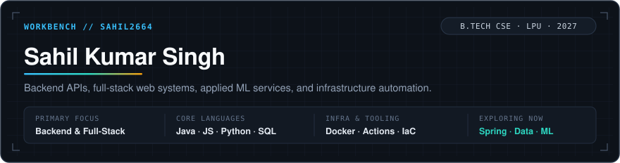
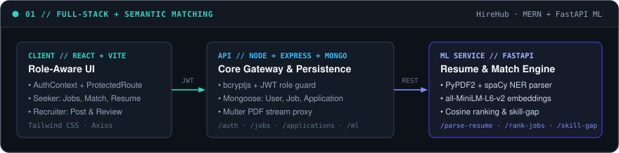
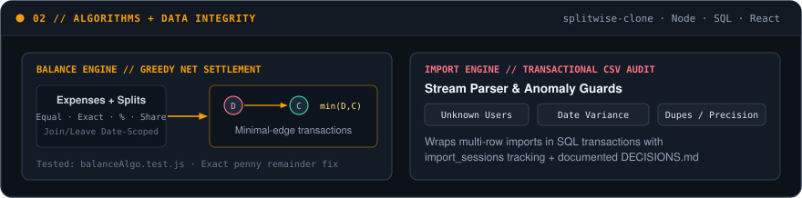
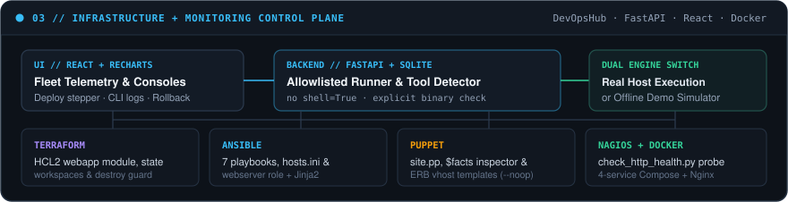
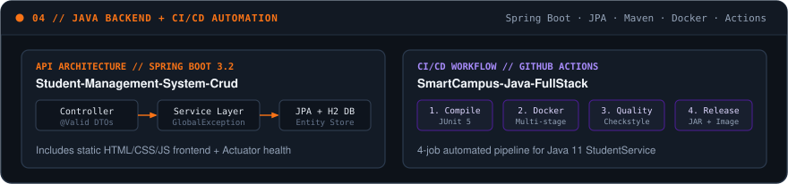
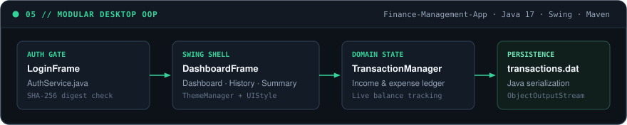
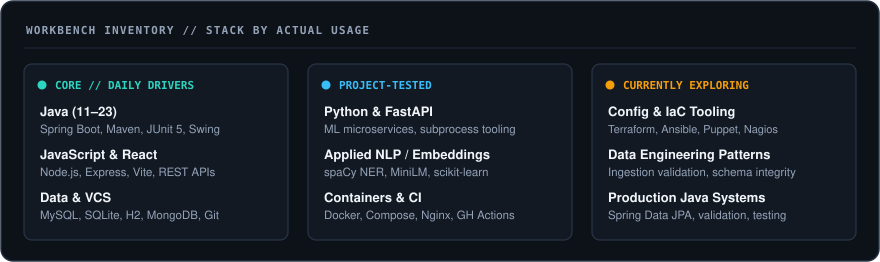
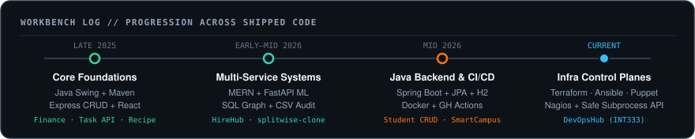

<p align="center">
  
</p>

<br/>

## Field Notes

I'm **Sahil Kumar Singh**, a Computer Science Engineering undergraduate at Lovely Professional University (Class of 2027).

Most of my time goes into building software from the inside out: designing relational schemas, wiring REST APIs with proper validation and access rules, wrapping Python ML models behind clean HTTP boundaries, and automating the infrastructure that runs them. I keep this profile as an engineering workbench—a record of systems I've actually built, the trade-offs behind them, and what I'm still figuring out.

```text
focus       →  software development · backend systems · data engineering · applied ML
working in  →  Java (Spring Boot, Maven) · JavaScript (Node, Express, React) · Python (FastAPI) · SQL
next up     →  stronger relational data modeling, backend testing, and reproducible deployments
```

---

## Things I've Built

Each project below approaches a different layer of software engineering—from multi-service web platforms and settlement algorithms to infrastructure control planes and Java backends.

<br/>

### 01 · HireHub — Full-Stack Job Portal with Semantic Resume Matching

<p align="center">
  
</p>

- **Problem it solves:** Job boards usually treat resumes as opaque file attachments and reduce matching to rigid keyword filters.
- **What I implemented:** A two-role MERN portal (`recruiter` and `seeker`) backed by JWT authentication, role-guarded endpoints, and a separate Python FastAPI ML microservice that parses uploaded PDF resumes and ranks open roles against candidate profiles.
- **Technology choices:** React + Vite + Tailwind on the client; Node.js, Express, MongoDB/Mongoose, `bcryptjs`, and Multer for the core API; FastAPI with `PyPDF2`, `spaCy` (`en_core_web_sm`), `sentence-transformers` (`all-MiniLM-L6-v2`), and `scikit-learn` for NLP & similarity scoring.
- **Why the implementation is interesting:** Keeping the ML inference layer isolated as a FastAPI service lets the Node gateway stream Multer PDF buffers directly to `/parse-resume`, persist structured skill/education metadata back into MongoDB, and run cosine similarity ranking (`/rank-jobs`) and skill-gap analysis (`/skill-gap`) without coupling Python dependencies to the Express process.
- **Repository:** [github.com/Sahil2664/HireHub](https://github.com/Sahil2664/HireHub)

<br/>

### 02 · Splitwise Clone — Group Expense Engine & CSV Anomaly Detector

<p align="center">
  
</p>

- **Problem it solves:** Splitting group expenses gets messy fast when members join or leave mid-trip, splits use mixed rules, or historical data arrives via inconsistent CSV exports.
- **What I implemented:** A full-stack shared expense tracker supporting equal, exact, percentage, and share-based splits, join/leave date-scoped group membership, a greedy Net Settlement Graph engine, and a transactional CSV import pipeline.
- **Technology choices:** Node.js + Express + Joi validation + `csv-parser` + SQL (`MySQL` / `SQLite`) on the backend; React + Vite + Axios + Vanilla CSS on the client.
- **Why the implementation is interesting:** Rather than storing brittle pairwise IOUs, `balanceService.js` collapses group history into net balances and runs a greedy debtor-creditor matching pass (verified by `balanceAlgo.test.js`) while reconciling fractional cent remainders. The CSV importer (`importController.js`) wraps rows in SQL transactions and flags unknown users, mixed date formats, duplicates, and rounding anomalies—all documented with explicit trade-offs in `DECISIONS.md`.
- **Repository:** [github.com/Sahil2664/splitwise-clone](https://github.com/Sahil2664/splitwise-clone)

<br/>

### 03 · DevOpsHub — Infrastructure Automation & Monitoring Control Plane

<p align="center">
  
</p>

- **Problem it solves:** Configuration management tools like Terraform, Ansible, Puppet, and Nagios usually live in disconnected terminals, making it hard to visualize fleet state, deployment stages, and health checks together.
- **What I implemented:** A unified FastAPI + React/Recharts workbench backed by SQLite, paired with real Terraform HCL2 modules, 7 Ansible playbooks + a `webserver` role, Puppet `site.pp` manifests + ERB templates, Nagios configs with a custom Python HTTP probe (`check_http_health.py`), and a 4-service Docker Compose + Nginx topology.
- **Technology choices:** Python 3.11 + FastAPI + Uvicorn + SQLite on the backend; React 18 + Vite + Tailwind + Recharts on the frontend; HCL2, YAML, Puppet DSL, and Docker Compose for the infrastructure layer.
- **Why the implementation is interesting:** Built around a strict **Dual-Mode Architecture**—in Real Mode, an allowlisted subprocess runner (`no shell=True`) checks whether host binaries exist and executes only approved commands; in Demo Mode, a faithful offline simulator lets the entire lifecycle (including typed `DESTROY` confirmation guards and Ansible rollbacks) be tested safely without cloud credentials.
- **Repository:** [github.com/Sahil2664/DevOpsHub](https://github.com/Sahil2664/DevOpsHub) *(local project prepared for push from `devopshub`)*

<br/>

### 04 · Java Backend & CI/CD Track — Spring Boot CRUD & SmartCampus Pipeline

<p align="center">
  
</p>

- **Problem it solves:** Academic CRUD exercises often skip request validation, global error contracts, automated testing, and reproducible container builds.
- **What I implemented:** Two complementary Java builds—a layered **Spring Boot 3.2 REST API** (`Student-Management-System-Crud-Application`) with DTO separation, Jakarta Bean Validation, `@RestControllerAdvice` exception handling, H2/JPA persistence, Actuator health endpoints, and a lightweight HTML/JS client; alongside **SmartCampus** (`SmartCampus-Java-FullStack`), a Maven + JUnit 5 student service wired to a multi-stage `Dockerfile` and a 4-job GitHub Actions workflow.
- **Technology choices:** Java 11–23, Spring Boot 3.2.6, Spring Data JPA, H2, Lombok, Maven, JUnit 5, Docker, GitHub Actions (`build-and-test`, `docker-build`, `code-quality`, `deployment-summary`).
- **Why the implementation is interesting:** Together they bridge application-layer design (explicit request/response DTOs instead of leaking JPA entities) and release engineering (automated Maven verification, Checkstyle checks, containerization, and build artifact retention on push).
- **Repositories:** [Student-Management-System-Crud-Application](https://github.com/Sahil2664/Student-Management-System-Crud-Application) · [SmartCampus-Java-FullStack](https://github.com/Sahil2664/SmartCampus-Java-FullStack)

<br/>

### 05 · Finance Management App — Modular Java Swing Desktop Ledger

<p align="center">
  
</p>

- **Problem it solves:** Moving beyond single-file desktop scripts into a structured, maintainable Java GUI application for tracking personal income, expenses, and running balances.
- **What I implemented:** A Maven-packaged Java 17 Swing desktop application separating login authentication (`AuthService` using SHA-256 hashing), themed UI panels (`DashboardPanel`, `HistoryPanel`, `SummaryPanel`, `ThemeManager`), and domain ledger persistence (`TransactionManager` serializing state to `transactions.dat`).
- **Technology choices:** Java 17, Swing / AWT, Maven (`maven-compiler-plugin`, `exec-maven-plugin`, executable JAR packaging).
- **Why the implementation is interesting:** Evolved directly from an earlier single-file prototype (`Personal-Finance-app`) into clean package-scoped classes with separated UI styling, auth, and storage responsibilities.
- **Repository:** [github.com/Sahil2664/Finance-Management-App](https://github.com/Sahil2664/Finance-Management-App)

<br/>

<details>
<summary><strong>Workbench Ledger — Supporting Builds &amp; Practice Logs</strong></summary>
<br/>

| Project | What It Is | Stack | Link |
| :--- | :--- | :--- | :--- |
| **Recipe Finder** | React SPA querying TheMealDB API with search, category filters, random discovery, and `localStorage` favorites/theme persistence | React · Axios · CSS | [recipe-finder-frontend](https://github.com/Sahil2664/recipe-finder-frontend) |
| **Task Manager API** | Modular Express CRUD service separating route definitions and controller logic over local `tasks.json` persistence | Node.js · Express · JSON FS | [task-manager-api](https://github.com/Sahil2664/task-manager-api) |
| **INT332 Daily Practice** | Lab notes and command logs covering container isolation and Docker Desktop fundamentals | Docker · Linux CLI | [INT332-Daily-Practice](https://github.com/Sahil2664/INT332-Daily-Practice) |
| **Cognizant DN5 Java FSE** | Hands-on exercises across Java, JUnit/Mockito, Angular, and React modules | Java · JUnit · Angular · React | [Cognizant-DN5-Java-FSE](https://github.com/Sahil2664/Cognizant-DN5-Java-FSE) |

</details>

---

## Technical Toolkit

Organized by how often I actually ship code with each tool rather than every keyword I've ever touched.

<p align="center">
  
</p>

---

## Progression Across Shipped Code

<p align="center">
  
</p>

---

## How I Approach Building

- **Write down the trade-offs.** Projects age better when you know *why* a relational database, greedy graph pass, or synchronous CSV stream was chosen over heavier alternatives.
- **Separate boundaries early.** Whether splitting an ML scorer out into FastAPI (`HireHub`) or isolating DTOs from JPA entities (`Student-Management-System-Crud-Application`), clean seams make debugging boring—in a good way.
- **Prefer honest behavior over illusions.** In `DevOpsHub`, if a host tool like Terraform or Ansible isn't installed locally, the API reports it plainly and keeps command execution behind an explicit allowlist without `shell=True`.
- **Ship working slices first.** Get the core data flow, edge cases, and tests solid before spending hours on surface polish.

---

## Currently Exploring

- **Backend & Data Engineering:** Deeper relational schema design, transaction boundaries, ingestion validation, and Spring Boot testing patterns.
- **Infrastructure & Reliability:** Bridging application code with reproducible Docker builds, CI pipelines, and declarative configuration management.
- **Applied ML Integration:** Learning how to evaluate NLP/classification pipelines rigorously and serve them reliably behind real backend services.

---

## Connect

[GitHub (`@Sahil2664`)](https://github.com/Sahil2664) · [LinkedIn (`/in/sahilsingh2664`)](https://www.linkedin.com/in/sahilsingh2664/) · [LeetCode (`Sahil_-Singh`)](https://leetcode.com/u/Sahil_-Singh/)
